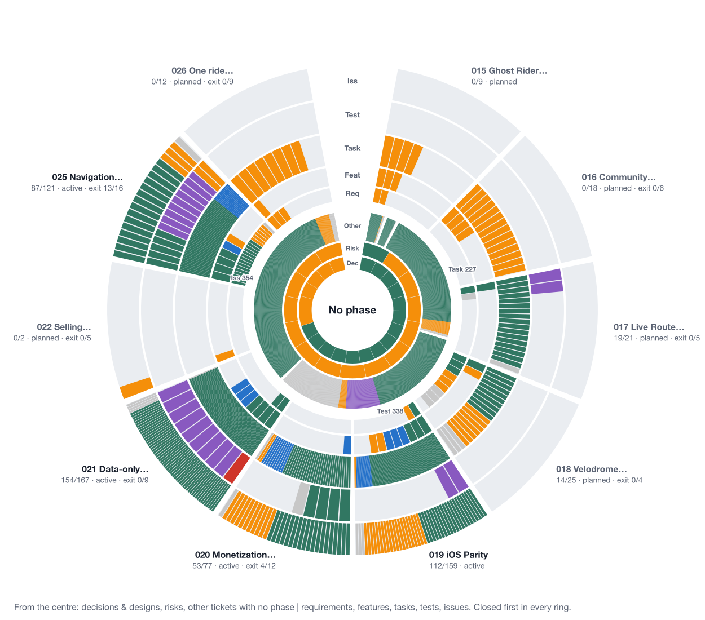
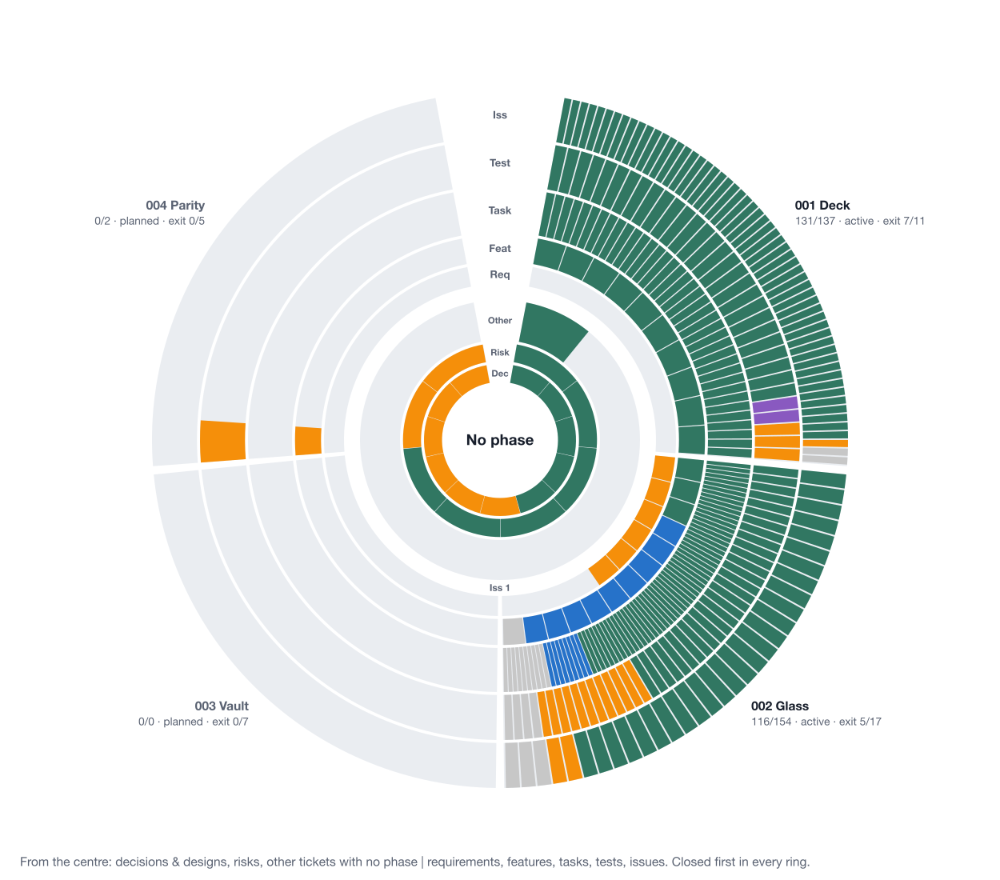
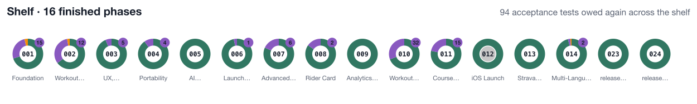
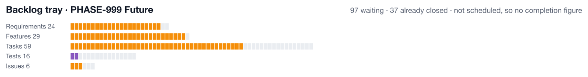
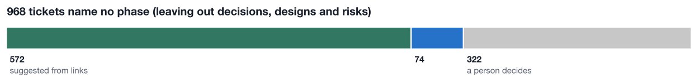
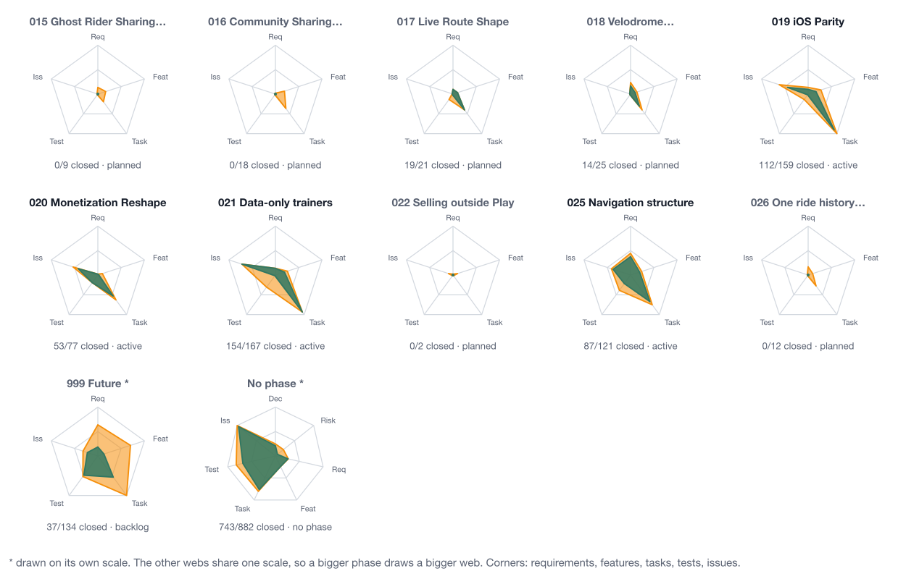
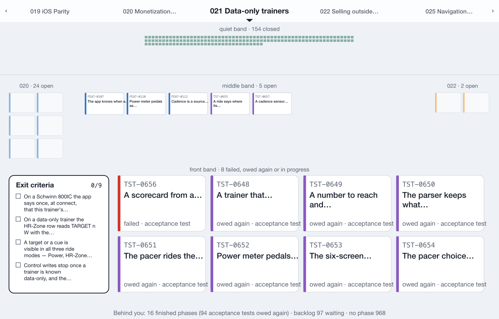
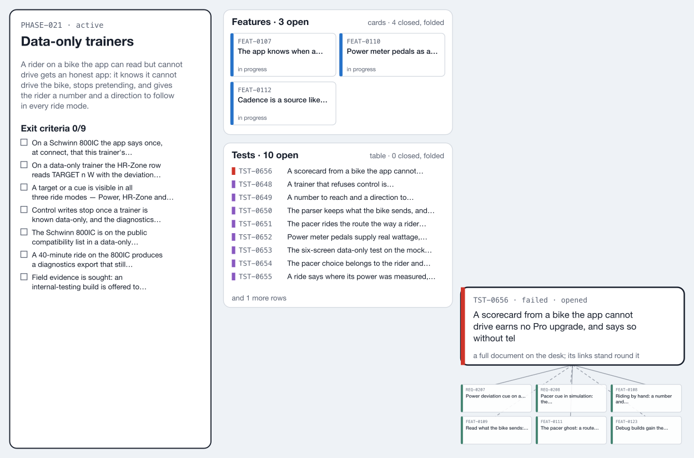
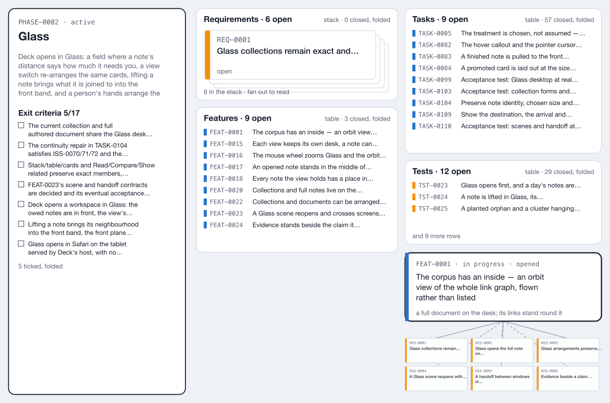

# The phase overview

## Problem

**Nothing in Deck or the cockpit shows, in one look, how far each phase has got and what is left in it.** The cockpit's overview shows one square per item, a digest, the validator report and a contribution grid ([[project-os-cockpit#DES-0001]], [[project-os-cockpit#DES-0004]]). You have to count squares to learn that a phase is finished but cannot close, or that most of what is left needs a person.

Edwin set Glass aside on 2026-10-08, after several rounds that did not convince him, and asked for one view to be got right first: the overview. He wants it laid out by phase, because that is how he reads a project, and he wants to see for each phase what is defined and what is done.

Two real workspaces were used to test every drawing. Deck itself has 4 phases and 333 tickets. your-trainer has 27 phases and 2,646 tickets. A design that only works on the small one is not a design for Deck.

## Approach

**Every ticket is drawn, and every ticket has one home.** The overview is built from a list of tickets, each with a type, a state and a place. All the drawings read that one list, so they cannot disagree.

### Ticket types and states

| Type | Closed | In progress | Open | Owed again | Failed | Dropped |
| --- | --- | --- | --- | --- | --- | --- |
| Requirements | implemented | — | approved, draft | — | — | retired, superseded |
| Features | done | doing, review | backlog, planned | — | — | cancelled, superseded, deferred |
| Tasks | done | doing | backlog | — | — | cancelled, superseded, deferred |
| Acceptance tests | every platform's latest result is a pass or excused | — | never run | a pass was withdrawn by a later change | any platform failed | retired |
| Automated tests | active or passing, with CI green | — | ready | — | failing | retired |
| Issues | fixed | — | open, triage | — | — | declined, deferred |
| Decisions, designs | accepted | — | proposed, draft | — | — | superseded, declined |
| Risks | closed | mitigating | open | — | — | — |

**"Owed again" is its own state.** An acceptance test whose pass was withdrawn is not unfinished work and not a failure. It is a retest the next release needs. In your-trainer, 257 passes were withdrawn across Android and iOS; drawn as failures, every phase looked broken.

Exit criteria are not tickets. They are checklist lines in the phase note, so they are counted next to the phase name and listed at the top of the phase page. A phase that writes its exit criteria as prose (your-trainer's PHASE-019 and PHASE-999) says so instead of showing a count.

### Where a ticket belongs

1. **Decisions, designs and risks are project-wide**, whatever `phase:` their note names (Edwin, 2026-10-08).
2. Otherwise the ticket's own `phase:` field.
3. Otherwise the phase note's member lists (`features:`, `tasks:`, `issues:` and the rest).
4. Otherwise the phase of the feature it is a child of, implements or covers.
5. Otherwise it has **no phase**, and Deck suggests one (see RE-PHASE below).

In your-trainer, 801 of 2,610 tickets (31%) have a phase of their own, and no test does. Rules 3 and 4 place another 841, and 968 are left with none.

### Three kinds of phase

- **Still to finish** (active or planned): a sector of the wheel.
- **Finished** (done or superseded): a disc on the shelf. A finished phase has nothing left to steer, so it gives up its sector. The disc keeps one mark: how many of its acceptance tests are owed again.
- **Backlog**: a tray of its own, grouped by type, with no completion figure, because nothing in it is scheduled. your-trainer's PHASE-999 Future is drawn this way. Drawn as a phase, it looked like the most unfinished phase in the project.

## The design

The interactive page is [DES-0004-phase-overview.html](DES-0004-phase-overview.html). It switches between your-trainer and Deck, generates every drawing from the tickets measured on 2026-10-08, and lets you select phases, accept re-phase suggestions and open the phase page. Its scripts do not run in Obsidian, so the plates below are still pictures of the same drawings.

### Plate 1: RINGS, the overview

your-trainer. Each sector is a phase still to finish, clockwise in phase order from the top. Each ring is a ticket type, from the type with the fewest tickets in the middle to the type with the most outside: requirements, features, tasks, tests, issues. Inside a ring, closed tickets come first, then in progress, failed, owed again, open and dropped. A wedge never takes more than a tenth of its sector, so a lone ticket stays small. The centre holds the tickets with no phase: decisions and designs, risks, and the rest split by type. Each phase's label gives closed over defined, its status and its exit criteria.

Deck, on the same rules. Deck's sector is green except two violet acceptance tests (TST-0010 and TST-0011, whose passes were withdrawn on 2026-09-08). Glass shows its features at review in blue and its requirements and acceptance tests open in amber. Vault is an empty track, because it has only exit criteria.

The shelf, under the wheel. One disc per finished phase, in order. A disc is a ring of its tickets by state. The violet badge counts acceptance tests owed again: 94 across your-trainer's shelf, 32 of them in PHASE-010. A superseded phase has a grey centre.

The backlog tray. Waiting tickets are coloured by state and closed ones are pale. It says how many are waiting, not how far along the backlog is.

### Plate 2: RE-PHASE

A ticket with no phase gets a suggestion in one of two ways. **From links**: the phase most of its linked tickets belong to. **From dates**: the only phase whose dates, from created to last updated, contain the day the ticket was created. Anything else is left for a person, because more than one phase fits or none does. In your-trainer that places 646 of 968 tickets. In Deck it places ISS-0089 in Glass.

The page lists the suggestions by phase with an Accept button per group. In the page, accepting only moves the tickets on screen. In Deck, it would write `phase:` into each note through the cockpit's sidecar. The sidecar has no "set phase" action yet, so that has to be asked of the cockpit first.

### Plate 3: WEBS

One web per phase still to finish. Each corner is a ticket type, and its distance from the centre is the square root of the count, on one scale for every phase, so a bigger phase draws a bigger web. The amber web joins the defined counts and the green web joins the closed counts, so the amber left showing is what is still open. The backlog and the no-phase tickets are drawn on their own scales and marked with an asterisk. The same web, larger, heads the phase page.

### Plate 4: MATRIX

MATRIX is in the interactive page only, because it is a table. Phases still to finish are rows, with one tick per ticket in each cell (a proportional bar past 120). The backlog and the no-phase tickets follow under a rule. Finished phases are a plain list underneath, each with its owed-again count.

### Plate 5: the phase page

The phase page is also in the interactive page only. It opens with the phase's web, its goal and its counts, then the exit criteria, then one group per type listing the open tickets (failed first, then owed again, in progress and open), at most 15 per group. Closed tickets fold into one line.

### Plate 6: the overview as a Glass field

The wheel becomes the Glass field, seen from its centre. Each phase still to finish is a direction you face; the compass across the top shows them in wheel order with the selected phase ahead, and turning brings the next one round. **Depth is state**, which is how Glass already treats priority: failed, owed-again and in-progress tickets stand in the front band as full cards; open tickets fill the middle band; closed tickets are small tiles in the quiet band at the horizon, still reachable. The neighbouring phases recede at the edges. The exit criteria travel with the phase as one card at the front left. Behind you are the shelf, the backlog and the no-phase tickets, which is where Glass already keeps what is out of the way. Selecting a card lifts it with its neighbourhood, as [[FEAT-0017-An-Opened-Note-Stands-In-The-Middle-Of-Its-Neighbours]] already does.

### Plate 7: a phase page as a Glass desk

your-trainer's PHASE-021. The phase note opens as a full document on the left, with its goal and exit criteria. Each ticket type with open tickets is a collection in one of [[FEAT-0022-Collections-And-Documents-Can-Be-Arranged-And-Restored]]'s three forms: cards for up to 4, a stack for up to 8, a table beyond that. Closed tickets stay in the collection, folded into one line. The failed acceptance test TST-0656 is open as a document with its linked tickets under it. The arrangement can be saved as a named scene ([[FEAT-0023-A-Glass-Scene-Reopens-And-Crosses-Screens-Without-Losing-Its-Work]]) and reopened later with live content.

The same desk for Deck's PHASE-0002 Glass, where nothing has failed, so the first ticket in progress (FEAT-0001) is the one opened.

## What the two workspaces showed

- **Finished phases would take most of the wheel.** your-trainer has 16 finished phases of 27. Moving them to the shelf gives each phase still to finish about 34 degrees instead of 13.
- **A third of your-trainer's tickets name no phase**: 968 of 2,646, mostly old and closed. They make the centre the heaviest part of the wheel until they are re-phased.
- **Finished phases still hold open tickets, and they are retests.** 97 of 98 are acceptance tests; 94 of those are owed again after release 2.1.8.
- **14 of your-trainer's 15 risks are open**, which paints the centre's risk ring amber. Whether an open risk is amber depends on whether risks there are a register that stays open while the hazard exists.
- **Every risk in Deck names a phase**, and so does DES-0003. If those types are project-wide by rule, their templates should stop asking for one.

## Open questions

1. **How is a backlog phase marked?** The page uses your-trainer's convention, an id ending in 999. A phase-note field such as `kind: backlog` would make it explicit.
2. **Does accepting a re-phase suggestion write to the notes**, through a new sidecar action, or stay Deck's own inference shown with a mark? Writing needs a request in the cockpit's capability register first.
3. **Is an open risk amber**, or neutral until it is mitigating?
4. **Which phase owns this work?** Building the overview is not Glass work. It could be a new phase before Glass resumes, or part of PHASE-0001.

## Out of scope

- **Building it.** This is a proposal. No feature or task exists yet.
- **The cockpit's overview.** Nothing here changes it. If the design is accepted, its capability-register row is where the cockpit would learn about it.
- **Mobile layout.** The served page would need the wheel and the phase page at tablet width; that is not drawn.
- **Dates and forecasts.** The overview shows state, not time. DES-0001's REEL and round one's TIDE were dropped for that reason.

## Revisions

- 2026-10-08 — written after four rounds in one session, each published to claude.ai (the two URLs in `source:`). Round one drew nine unrelated overviews; Edwin kept RINGS and STARS because they tie items to a phase. Round two added ticket types, project-wide tickets and drill-down. Round three drew one wedge per ticket, ordered the rings from fewer to more, made decisions and risks project-wide, removed exit criteria as a ring, and turned the stars into webs. Round four, recorded here, moved finished phases to a shelf, drew the backlog as a tray, added re-phase suggestions and the "owed again" state, and drew the overview and a phase page as Glass.

## Review

<Comments land here, each naming what it is about in its own words. Verdicts go in the frontmatter, transcribed from a review that actually happened — never anticipated.>
