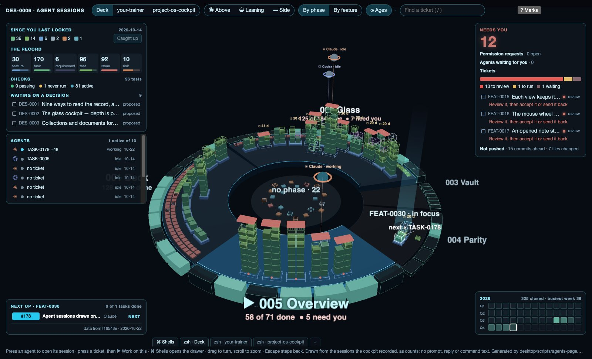
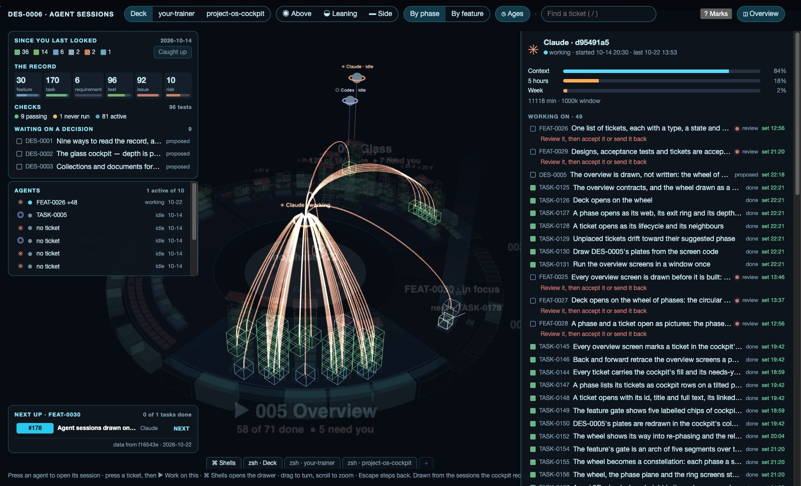
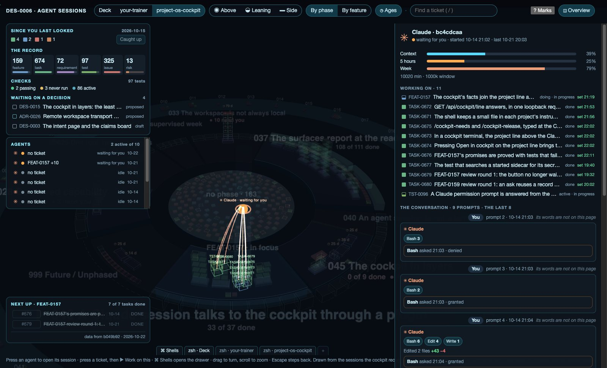
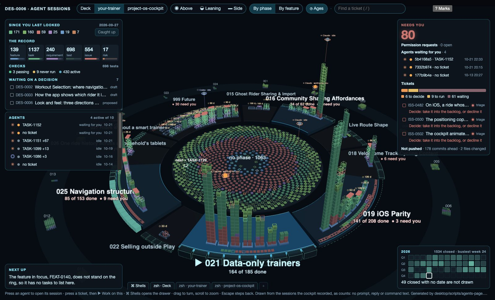
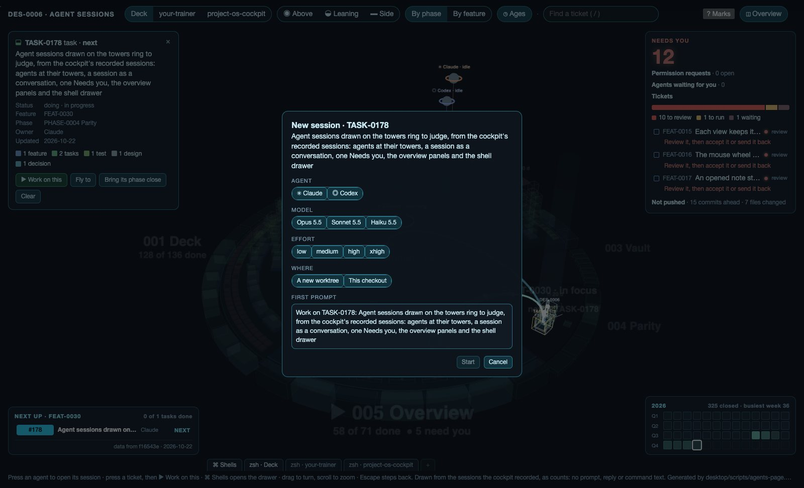
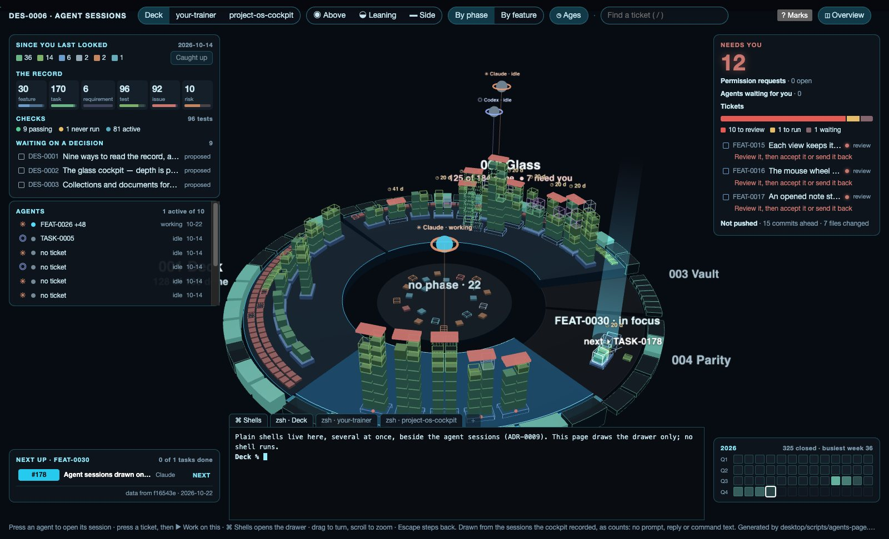

# Agent sessions stand beside the work

**Deck's own Claude and Codex sessions stand on the towers ring at the tickets they work on, and one opens as a session in the right pane, the way T3 Code draws one** ([[ADR-0009-Deck-Runs-Its-Own-Agent-Sessions-Drawn-As-Conversations]]). Needs you gathers permission requests, waiting agents, tickets and unpushed work in one panel. The cockpit's overview panels become pictures, plain shells sit in a drawer, and "Work on this" on a ticket starts a session. Edwin is asked what to change before any of it is built, after [[PHASE-0005-Overview]].

The page is [DES-0006-agent-sessions.html](DES-0006-agent-sessions.html), written by `desktop/scripts/agents-page.mjs` on the towers page's own code. It switches between Deck, your-trainer and the cockpit's own repository, the only one where the cockpit has recorded permission requests. It is drawn from the sessions the cockpit recorded in each repository's `.cockpit/` folder up to 2026-10-22, reduced by `desktop/scripts/agents-fixture.mjs` to ids, states, times, tickets and counts: **no prompt, reply or command text is on it**, so the conversation is drawn as counts. Each workspace's ring is its tickets as they stood that day.

## What the page draws

- **Agents at their towers.** Each recorded session stands as a marker over the tower or tile of the ticket it last moved on: its colour is its state (working, waiting for you, idle) and its ring its agent (✳ Claude, ◎ Codex). A working session breathes, as the focus feature's tasks do. Sessions that changed no ticket the workspace holds are not on the ring but in the Agents list.
- **The Agents list, left middle**: every recorded session, its agent and state, the ticket it worked on and how many more, and when it was last active. Pressing one opens it.
- **A session opened**, by pressing its marker or its row. Its tickets light and are joined to it by curves; the rest fades. The right pane shows, top to bottom:
  - the agent, the session's id, its state and its times;
  - its context, five-hour and weekly use as bars, and its minutes (not its cost: Deck's repository is public, and Edwin left the dollar cost out on 2026-10-22);
  - the tickets it worked on as cockpit rows, each with the status it moved it to and when;
  - the conversation: its prompts and its steps as tool chips (Bash 480, Edit 27, Read 5);
  - its permission requests, the latest drawn with Approve and Deny as it stood before it was answered;
  - Resume, Open its shell and Stop.
- **One Needs you, top right.** Its count adds open permission requests and waiting agents to the tickets that need you. Below the count come permission requests (open, and the last one with its outcome), the agents waiting for you (pressing one opens it), the tickets by reason as on the towers page, and what is not pushed: commits ahead of the upstream and files changed.
- **The cockpit's overview panels, top left**, in place of the legend (which "? Marks" brings back):
  - since you last looked: tickets changed since the cockpit's last catch-up, by type, with Caught up;
  - the record: each type's count with a bar of how far along it is;
  - the checks: tests passing, never run and active;
  - waiting on a decision: designs and decisions still proposed or draft.
- **The shell drawer, bottom.** ⌘ Shells opens a drawer of plain shells, one tab each, several at once. It draws the drawer only; no shell runs.
- **Work on this.** A ticket's card has ▶ Work on this. It opens a new session with the agent, model, effort and worktree to choose, and the ticket's own words as the first prompt: what it asks of you when it needs you, else "Work on" and its title.
- The towers page's pictures are not drawn here: they would cover the agents standing over the same towers.

Deck on 2026-10-22: this session, Claude d95491a5, working, stands over Overview; an idle Claude and Codex stand over Glass. Needs you counts 11: nine to review, one to run, one waiting; nothing is waiting on a permission. Three commits are ahead and nine files changed.

The session opened: 47 tickets joined to it, context 67% of its 1,000k window over 11,089 minutes, and every ticket it moved with when.

The cockpit's repository: Claude bc4cdcaa, waiting for you, worked on eleven tickets, FEAT-0157 and its tasks among them, ran Bash 480 times, and asked six permissions on 14 October, drawn with their outcomes.

your-trainer: four sessions wait for you, six stand on the ring; 178 commits are ahead of the upstream.

Work on this, on TASK-0179: Claude or Codex, the model, the effort, a new worktree or this checkout, and the ticket's title as the first prompt.

The shell drawer open over the ring, with a tab for each workspace.

The other pictures are [agents-your-trainer-session.jpg](__attachments__/DES-0006/agents-your-trainer-session.jpg), [agents-your-trainer-work.jpg](__attachments__/DES-0006/agents-your-trainer-work.jpg), [agents-your-trainer-drawer.jpg](__attachments__/DES-0006/agents-your-trainer-drawer.jpg), [agents-cockpit-ring.jpg](__attachments__/DES-0006/agents-cockpit-ring.jpg), [agents-cockpit-work.jpg](__attachments__/DES-0006/agents-cockpit-work.jpg) and [agents-cockpit-drawer.jpg](__attachments__/DES-0006/agents-cockpit-drawer.jpg).

## What building it would take

In [[PHASE-0004-Parity]], after Overview, by [[ADR-0009-Deck-Runs-Its-Own-Agent-Sessions-Drawn-As-Conversations]]: the Agent SDK and `codex app-server` in Deck's main process; the sidecar's shell secret for answering permissions; reporting each session to the sidecar so either app sees it; node-pty for the drawer; the cockpit's overview routes added to Deck's allowed list; and a write for Caught up, which ADR-0003 does not cover yet. A real session pane shows the messages themselves, which this page cannot.

## What is Edwin's to decide

- Whether agents should stand over the ticket they last moved on, as here, or over the ticket they were started on.
- Whether the session pane should replace the ticket pane, as here, or stand beside it.
- Whether the overview panels belong on the ring's screen at all times, or behind a button, given how much the ring's screen now holds.
- Whether Needs you should put permission requests first, as here, even above the tickets you were asked to review.
